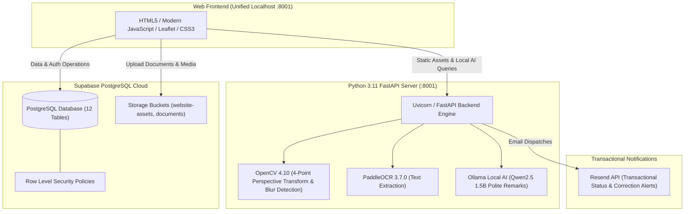

# PIGEM Web-Based Internet Service Application System

<p align="center">
  
</p>

<p align="center">
  <strong>Enterprise-Grade Customer Acquisition, Geolocation Pinning, AI Document Screening, and Operations Management Platform</strong><br>
  <em>Developed for Combined Facilities Support Services (PIGEM) — Dasmariñas City, Cavite, Philippines</em>
</p>

<p align="center">
  <a href="http://127.0.0.1:8001/"></a>
  <a href="https://supabase.com"></a>
  <a href="https://fastapi.tiangolo.com"></a>
  <a href="https://www.python.org/downloads/release/python-3119/"></a>
  <a href="https://opencv.org/"></a>
  <a href="https://github.com/PaddlePaddle/PaddleOCR"></a>
  <a href="https://resend.com"></a>
  <a href="https://ollama.com"></a>
</p>

---

## 📋 Table of Contents

- [📌 Project Overview](#-project-overview)
- [🌐 Localhost System Portals](#-localhost-system-portals)
- [🏛 System Architecture](#-system-architecture)
- [✨ Core Functional Modules](#-core-functional-modules)
- [🚀 Quick Start Guide (1-Click Run)](#-quick-start-guide)
- [🗄️ Database Reset & Clean Schema](#-database-reset--clean-schema)
- [🛡 Security, Audit & Data Privacy](#-security-audit--data-privacy)

---

## 📌 Project Overview

The **PIGEM Web-Based Internet Service Application System** is a unified, privacy-first web platform and on-premises AI screening engine built to streamline the customer onboarding and service provisioning lifecycle for residential **Red Fiber** broadband subscriptions.

Operating in **Dasmariñas City, Cavite** and adjacent coverage areas across Greater Manila, the platform replaces paper application forms with an interactive, geolocated digital submission workflow, automated on-premises identification document screening, multi-tier staff desks, and transactional email notifications.

### Primary Objectives
1. **Paperless Customer Onboarding:** Interactive subscriber forms with GPS map pinning (Leaflet / OpenStreetMap).
2. **On-Premises Privacy-Preserving Screening:** Automated document image quality evaluation (blur, brightness, orientation, 4-point homography deskew) and text extraction using **OpenCV** and **PaddleOCR**, paired with a local **Ollama (Qwen2.5 1.5B)** polite remark rewriter.
3. **Application Management Subsystem:** Queueing, claim, review, and status tracking for Verification Agents, alongside manager oversight, agent workload tracking, and Content CMS.
4. **Manual Red Fiber RADIUS Encoding:** Verification agents record official provider circuit IDs and reference numbers after manual entry into the Red Fiber RADIUS portal.
5. **Zero Demo Accounts:** Clean production database starting empty, with authenticated staff roles.

---

## 🌐 Localhost System Portals

When running `START-AI.bat`, the FastAPI server directly mounts and serves the web application at `http://127.0.0.1:8001/`. This guarantees zero CORS errors and zero mixed-content issues.

> 📄 **Quick Text Reference:** See [`LOCAL_ACCESS_URLS.txt`](./LOCAL_ACCESS_URLS.txt) for a copy-pasteable directory of all portal links.

### 1. External Customer Subsystem (Public Facing)
| Portal | Direct Local URL | Description |
| :--- | :--- | :--- |
| **Home Landing Page** | [http://127.0.0.1:8001/index.html](http://127.0.0.1:8001/index.html) | Plan showcase, promotional banners, coverage area text. |
| **Corporate About** | [http://127.0.0.1:8001/about.html](http://127.0.0.1:8001/about.html) | Company history, field operations, and facilities profile. |
| **Online Application** | [http://127.0.0.1:8001/apply.html](http://127.0.0.1:8001/apply.html) | Registration form, GPS map pinning, valid ID upload, reCAPTCHA. |
| **One-Time Activation** | [http://127.0.0.1:8001/activate.html](http://127.0.0.1:8001/activate.html) | OTP verification and subscriber password initialization. |
| **Customer Login** | [http://127.0.0.1:8001/login.html](http://127.0.0.1:8001/login.html) | Authentication gate with reCAPTCHA v2 protection. |
| **Customer Dashboard** | [http://127.0.0.1:8001/customer.html](http://127.0.0.1:8001/customer.html) | Application status lifecycle, agent remarks, and correction resubmissions. |
| **Privacy Policy** | [http://127.0.0.1:8001/privacy.html](http://127.0.0.1:8001/privacy.html) | RA 10173 data handling disclosures and legal advisory. |

### 2. Internal Staff & Operations Subsystems
| Portal | Direct Local URL | Description |
| :--- | :--- | :--- |
| **Staff Authentication** | [http://127.0.0.1:8001/staff-login.html](http://127.0.0.1:8001/staff-login.html) | Secure login for Verification Agents and Operations Managers. |
| **Agent Verification Desk** | [http://127.0.0.1:8001/agent.html](http://127.0.0.1:8001/agent.html) | Application queue, ID screening, polite remark generator, manual RADIUS encoding. |
| **Operations Manager CMS** | [http://127.0.0.1:8001/manager.html](http://127.0.0.1:8001/manager.html) | Pipeline oversight, agent provisioning, workload metrics, and Content CMS. |

### 3. Technical Administration Subsystem
| Portal | Direct Local URL | Description |
| :--- | :--- | :--- |
| **Admin Login** | [http://127.0.0.1:8001/admin-login.html](http://127.0.0.1:8001/admin-login.html) | Secure gate for Technical Administrators. |
| **Technical Console** | [http://127.0.0.1:8001/admin.html](http://127.0.0.1:8001/admin.html) | Local AI server health diagnostics, audit logs, and maintenance toggles. |
| **Account Provisioning** | [http://127.0.0.1:8001/setup-accounts.html](http://127.0.0.1:8001/setup-accounts.html) | Primary account setup with permanent Admin lockout protection. |

---

## 🏛 System Architecture



---

## ✨ Core Functional Modules

1. **User Authentication Subsystem:**
   - Isolated sessions for Customer, Agent, Manager, and Admin.
   - Client-side SHA-256 password hashing with Supabase Auth synchronization.
   - Google reCAPTCHA v2 with automatic localhost development key switching.
   - Admin account registered as **Denzel Fortez, Age: 21, Dasmariñas City, Cavite** with permanent card lock.

2. **Online Application Form:**
   - Red Fiber Plans (Plan 1000, Plan 1400, Plan 1900).
   - Valid ID upload (Front & Back) with client-side preview.
   - Geolocation address capture with Cavite reference coordinates.

3. **Application Management Subsystem:**
   - Verification agent queue: Claim, review, approve, request correction, or reject.
   - Preset common and rare validator remarks with local AI polite message rewriting.
   - Manual Red Fiber RADIUS portal verification and provider reference recording.
   - Manager dashboard with live workload metrics, referral links, agent provisioning, and Content CMS with Maintenance Mode protection.

4. **Technical Management Subsystem:**
   - Technical Admin Console for local AI diagnostics and screening engine controls.
   - OpenCV 4-Point Homography Perspective Transform (document auto-deskew).
   - Laplacian blur detection, contrast variance, and brightness analysis.
   - PaddleOCR text cross-matching (Legal Name and ID Number).
   - Immutable security and screening activity audit logs.

5. **Notification Subsystem:**
   - Resend transactional email dispatches for application status updates, customer correction update requests, and encoding notices.

---

## 🚀 Quick Start Guide

### Step 1: Start the Server
Double-click `START-AI.bat` in `C:\pigem-system`:
```powershell
cd C:\pigem-system\api
.\.venv311\Scripts\activate
uvicorn main:app --host 127.0.0.1 --port 8001
```

### Step 2: (Optional for Local AI Remarks) Start Ollama
```powershell
ollama run qwen2.5:1.5b
```

### Step 3: Open in Browser
Open: **[http://127.0.0.1:8001/index.html](http://127.0.0.1:8001/index.html)**

---

## 🗄️ Database Reset & Clean Schema

The clean database schema is located in [`supabase/schema.sql`](./supabase/schema.sql). To reset your Supabase project:
1. Open [Supabase SQL Editor](https://supabase.com/dashboard/project/wuunqfxyejxwrawtjdrf/sql/new).
2. Copy and paste the contents of `supabase/schema.sql`.
3. Press `Ctrl` + `A` to ensure the entire script is selected, then click **RUN**.
4. Open [http://127.0.0.1:8001/setup-accounts.html](http://127.0.0.1:8001/setup-accounts.html) to provision your official accounts.

---

## 🛡 Security, Audit & Data Privacy

* **Zero Cloud ID Leaks:** OpenCV and PaddleOCR run 100% on-premises. Government ID images are never sent to third-party public AI providers.
* **RA 10173 Compliance:** Application data and uploaded valid IDs are strictly compartmentalized with Row-Level Security (RLS).
* **Password Encryption:** Passwords are SHA-256 hashed on the client and bcrypt-secured within Supabase Authentication.
