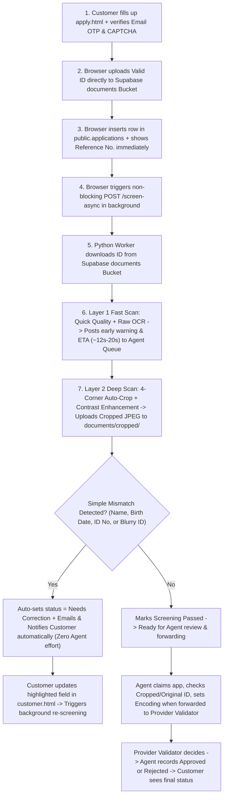

# PIGEM Web-Based Internet Service Application System - Complete Technical Study Guide

Ang study guide na ito ay kumpletong reviewer para maintindihan mo nang buo ang buong **PIGEM Web-Based Internet Service Application System** mula frontend hanggang backend, database queries, API routes, programming concepts (OOP, Regex, at nested logic), at lahat ng functions at methods na ginagamit sa system.

---

## 1. System Overview at End-to-End Application Flow

Ang system ay dinevelop para sa **PIGEM Combined Facilities Support Services** sa Dasmarinas City, Cavite bilang online application, document screening, at monitoring platform para sa residential **Red Fiber** internet plans.

### 1.1 Apat na User Roles at Separation ng Portals

| Role | Portal File | Login Page | Main Responsibility sa System |
| :--- | :--- | :--- | :--- |
| **Customer** | `web/customer.html` | `web/login.html` | Nagpapasa ng internet application sa `apply.html`, nag-a-activate ng account sa `activate.html`, tumitingin ng 3 main statuses (`Processing`, `Approved`, `Rejected`), at nag-a-update ng details kapag lumabas ang `Needs Correction` sa loob ng `Processing`. |
| **Agent** | `web/agent.html` | `web/staff-login.html` | Nagha-handle ng customer applications sa queue, nakakakita ng live progress at estimated remaining time ng background screening, nagvi-view ng `Cropped & Enhanced Copy` vs `Original Uploaded Photo`, nagfo-forward sa validator (`Encoding`), at nagre-record ng validator decision (`Approved` o `Rejected`). |
| **Manager** | `web/manager.html` | `web/staff-login.html` | Nagmo-monitor ng lahat ng applications at workload ng mga agents, pwedeng mag-reassign o mag-override ng status, gumagawa ng bagong Agent accounts, nagpapadala ng promotional email campaigns, at nag-e-edit ng public website content sa Content CMS. |
| **Admin** | `web/admin.html` | `web/admin-login.html` | Humahawak ng **Technical Management System**: dito lang makikita at makokontrol ang AI Screening Engine, active parallel background screening jobs, Ollama, OpenCV, PaddleOCR, Gmail SMTP, Supabase health checks, Maintenance Mode, system accounts, at audit logs. |

> [!IMPORTANT]
> **Non-Technical Terminology Rule:** Sa buong Customer, Agent, at Manager portals pati sa lahat ng customer emails, walang lumalabas na technical acronyms gaya ng `AI`, `OpenCV`, `PaddleOCR`, o `Ollama`. Ang nakikita lang ng staff at customer ay simpleng operational terms gaya ng **Screening**, **Screening in Progress**, **Cropping & Verifying**, **Document Quality**, at **Generate Polite Message**. Tanging ang **Admin** sa `admin.html` ang may access sa technical AI at API controls.

### 1.2 Step-by-Step Flow ng Isang Application



1. **Instant Submission para sa Customer (`apply.html` -> Supabase)**:
   Pagkatapos mag-fill up ng form ang customer at mag-click ng Submit, ang loading screen ay para lang sa pag-transfer ng form data, pag-upload ng Valid ID front at back derecho sa Supabase Storage bucket na `documents`, at pag-generate ng Reference Number (`PIGEM-...`). Hindi pinaghihintay ang customer sa pagbabasa o pag-enhance ng ID.
2. **Parallel Background Screening (`POST /screen-async` -> `api/screening.py`)**:
   Pagka-save ng application sa `public.applications`, tinatawag ng browser nang asynchronous ang `POST /screen-async`. Gumagamit ang server ng `ThreadPoolExecutor(max_workers=4)` kaya kahit maraming customer ang sabay-sabay mag-apply, sabay-sabay din silang mapoproseso sa background.
3. **Layer 1 (Fast Scan at Early Warning para sa Agent)**:
    Kinukuha ng Python worker ang ID mula sa `documents` bucket at nagpapatakbo agad ng mabilis na quality check at unang basa ng text. Habang tumatakbo pa lang ang screening, kita na agad ng Agent sa queue ang original submission ng customer kung gusto na niya itong buksan o ipasa, pero kung malabo ang ID o may mismatch sa unang tingin, naglalabas agad ang Layer 1 ng **"Hold Recommended"** warning kasama ang estimated time (halimbawa `~20s remaining`) para sabihan ang Agent na mas magandang hintayin matapos ang full enhancement.
4. **Layer 2 (Auto-Crop, Enhancement, at Cropped Copy sa Bucket)**:
   Hinahanap ng OpenCV ang 4 corners ng ID card, dine-deskew o tinutuwid ang tabinging kuha, kino-crop ang sobrang background, at nililinawan ang contrast gamit ang LAB + CLAHE. Sine-save ang bagong cropped JPEG sa `documents/cropped/` bucket para pwedeng mag-switch ang Agent sa pagitan ng **Cropped & Enhanced Copy** at **Original Uploaded Photo**.
5. **Automatic Request sa Simpleng Mismatch**:
   Kapag nakumpirma sa Layer 2 na may simpleng discrepancy gaya ng **Full Name mismatch**, **Birth Date mismatch**, **ID Number mismatch**, o **Blurry/Unreadable ID**, kusa nang gagawa ng magalang na mensahe ang backend, ise-set ang internal status sa `Needs Correction`, at magpapadala ng email at portal notification derecho sa customer nang hindi na kailangang mag-type o mag-click ng Agent. Makikita naman sa Agent workspace na nag-auto-request na ang system.
6. **Strictly 3 Customer Statuses (`Processing`, `Approved`, `Rejected`)**:
   Sa `customer.html`, tatlong status lang ang nakikita ng customer: **`Processing`**, **`Approved`**, at **`Rejected`**. Ang `Needs Correction` ay lumalabas lang bilang branch sa loob ng **`Processing`** kapag may pinapa-update sa customer, at bumabalik ulit sa normal na `Processing` pagka-resubmit niya. Sa panig naman ng Agent, nananatili ang **`Encoding`** kapag naipasa na sa Provider Validator (habang `Processing` pa rin ang tingin ng customer), at ang Validator ang nagdedesisyon kung **`Approved`** o **`Rejected`**.

---

## 2. Technologies, Installation Commands, at Paano Patakbuhin ang System

### 2.1 Mga Ginamit na Technologies at Bakit Ito ang Pinili

- **HTML5, CSS3, at Vanilla JavaScript (`web/`)**: Ginamit nang walang mabigat na frontend framework para mabilis mag-load, madaling basahin ang DOM manipulation, at malinaw ang bawat event handler.
- **Supabase (`@supabase/supabase-js@2` + REST API)**: Cloud backend na nagbibigay ng **PostgreSQL** database, **GoTrue Authentication**, at **Storage Buckets** (`website-assets` para sa public banners/logos at `documents` para sa customer Valid IDs at cropped copies).
- **Python 3.11 (`api/.venv311`)**: Piniling version dahil dito pinaka-compatible ang prebuilt C++ wheels ng `PaddleOCR` at `PaddlePaddle` sa Windows.
- **FastAPI at Uvicorn (`api/main.py`)**: Ang **FastAPI** ang Python web framework na gumagawa ng REST endpoints (`/health`, `/screen-async`, `/screen`, `/notify`, `/polite-remark`) at nagse-serve ng `web/` folder. Ang **Uvicorn** naman ang ASGI web server na nagpapatakbo sa FastAPI sa `http://127.0.0.1:8001`.
- **OpenCV (`opencv-python-headless`, `api/quality.py`)**: Computer vision library na sumusukat ng sharpness (Laplacian variance), brightness, glare, at contrast, at nagco-crop/nagtu-tuwid ng ID card gamit ang Canny edge detection at 4-point perspective transform.
- **PaddleOCR (`paddleocr` + `paddlepaddle`, `api/ocr.py`)**: Deep-learning Optical Character Recognition engine na bumabasa ng nakaprint na pangalan, petsa, at ID number mula sa Valid ID photo nang offline sa local server.
- **Ollama (`qwen2.5:1.5b`, `api/ai.py`)**: Local language model runner sa `http://localhost:11434` na gumagawa ng plain-English screening summary para sa staff at magalang na 2-sentence correction message para sa customer nang hindi lumalabas sa internet ang pribadong ID details (Data Privacy Act RA 10173). May built-in rule-based fallback din kapag naka-off ang Ollama.
- **Python `smtplib` + `ssl` (`api/mailer.py`)**: Built-in Python library na kumokonekta sa Gmail SMTP (`smtp.gmail.com:587`) gamit ang 16-character Google App Password para magpadala ng branded HTML emails.
- **Leaflet.js + OpenStreetMap + Nominatim (`apply.html`, `apply.js`)**: Libreng interactive map kung saan pwedeng mag-pin ng bahay ang customer o gamitin ang GPS (`navigator.geolocation`), tapos automatic na pupunan ang street, barangay, city, at province via reverse geocoding.
- **Google reCAPTCHA v2 (`home.js`, `login.js`, `apply.js`)**: Anti-bot security verification bago makapag-apply o makapag-sign in.

### 2.2 Commands sa Pag-download at Pag-install ng Lahat ng Technologies

Patakbuhin ang mga sumusunod sa **PowerShell** kapag magse-setup sa bagong Windows PC:

```powershell
# 1. I-install ang Python 3.11 at Ollama
winget install Python.Python.3.11
winget install Ollama.Ollama

# 2. I-download ang local language model para sa Ollama
ollama pull qwen2.5:1.5b

# 3. Pumunta sa api folder at gumawa ng isolated Python 3.11 virtual environment (.venv311)
cd C:\pigem-system\api
py -3.11 -m venv .venv311

# 4. I-activate ang virtual environment at i-install ang lahat ng Python packages
.\.venv311\Scripts\activate
pip install -r requirements.txt
```

Laman ng `api/requirements.txt`:

```text
fastapi==0.115.6
uvicorn==0.34.0
python-multipart==0.0.20
python-dotenv==1.0.1
httpx==0.28.1
numpy==1.26.4
opencv-python-headless==4.10.0.84
paddlepaddle==2.6.2
paddleocr==2.8.1
```

### 2.3 Pag-configure ng `api/.env`

Gumawa ng `C:\pigem-system\api\.env` mula sa `.env.example`:

```powershell
cd C:\pigem-system\api
copy .env.example .env
```

Format ng laman ng `api/.env`:

```ini
SUPABASE_URL=https://your-project-id.supabase.co
SUPABASE_ANON_KEY=your-supabase-anon-key
OLLAMA_URL=http://localhost:11434
OLLAMA_MODEL=qwen2.5:1.5b
SMTP_HOST=smtp.gmail.com
SMTP_PORT=587
SMTP_USER=yourgmail@gmail.com
SMTP_PASSWORD=abcd efgh ijkl mnop
SMTP_FROM=PIGEM Combined Facilities Support Services <yourgmail@gmail.com>
```

### 2.4 Commands sa Pag-start ng System

Buksan ang unang terminal para sa Ollama model service:

```powershell
ollama run qwen2.5:1.5b
```

Buksan ang pangalawang terminal (o i-double click ang `START-AI.bat`) para patakbuhin ang FastAPI + Uvicorn server:

```powershell
cd C:\pigem-system\api
$env:PYTHONDONTWRITEBYTECODE="1"
.\.venv311\Scripts\python.exe -m uvicorn main:app --host 127.0.0.1 --port 8001
```

> [!TIP]
> Ang `PYTHONDONTWRITEBYTECODE=1` sa `START-AI.bat` ay pumipigil sa Python na gumawa ng `__pycache__` at `.pyc` files para manatiling malinis ang folder structure.

---

## 3. Core Programming Concepts na Ginamit sa Codebase (OOP, Regex, at Nested Logic)

Mahalagang alam mo kung saan mismo sa code ginamit ang **Object-Oriented Programming (OOP)**, **Regular Expressions (Regex)**, at **Nested Statements/Loops** dahil madalas itong tanungin ng panel sa code walkthrough.

### 3.1 Object-Oriented Programming (OOP) Pillars sa System

| OOP Pillar | Kahulugan sa Simpleng Taglish | Saan Ginamit sa PIGEM Codebase |
| :--- | :--- | :--- |
| **Abstraction** | Paggawa ng base/parent class na nagtatakda ng common template o method signature (`raise NotImplementedError`) nang hindi pa nilalagay ang specific implementation details. | `BaseTokenVerifier` (`auth.py`), `BaseImageProcessor` (`quality.py`), `BaseTextMatcher` (`ocr.py`), `BaseLanguageClient` (`ai.py`), `BaseCloudGateway` (`screening.py`), at `BaseFieldValidator` (`config.js`). |
| **Inheritance** | Pagmana ng child class sa properties at helper methods ng parent class para hindi paulit-ulit ang code (`DRY - Don't Repeat Yourself`). | Minamana pareho ng `FastQualityScanner` (Layer 1) at `DocumentCropEnhancer` (Layer 2) ang `_decode_bytes()` at `_four_point_transform()` mula sa `BaseImageProcessor` sa `quality.py`. Sa frontend, minamana ng `ApplicantFormValidator` ang regex cleaners ng `BaseFieldValidator` sa `config.js`. |
| **Encapsulation** | Pagtatago ng internal attributes at helper logic sa loob ng isang class gamit ang underscore prefix (`_engine`, `_lock`, `_ollama_url`, `_active_jobs`) para hindi aksidenteng mabago mula sa labas. | Sa `PaddleOcrService` (`ocr.py`), naka-encapsulate ang `_engine` at `threading.Lock()` na `_lock` sa loob ng class. Sa `BackgroundScreeningCoordinator` (`screening.py`), naka-encapsulate ang `_executor` at `_active_jobs` dictionary. |

### 3.2 Regular Expressions (Regex) sa System

Ginagamit ang Regex para mag-validate ng formats, mag-extract ng dates/OTP codes, at maglinis ng text:
1. **Bearer Token Parsing (`api/auth.py`)**: `r"^Bearer\s+([A-Za-z0-9._\-]+)$"` — sinisigurado na valid JWT/Bearer header ang pinasa bago tawagan ang Supabase Auth.
2. **ID Format Validation (`web/js/config.js`)**: Bawat isa sa 25 Valid ID types ay may sariling Regex pattern, halimbawa `/^(\d{12}|\d{16})$/` para sa National ID at `/^[A-Z]\d{10}$/` para sa Driver's License.
3. **OCR Text & Date Extraction (`api/ocr.py`)**: Gumagamit ng `r"[^A-Z0-9]"` para tanggalin ang spaces at dashes sa ID number bago ikumpara, at apat na date regex patterns (`_ISO_DATE_REGEX`, `_MDY_DATE_REGEX`, `_WORD_DATE_1_REGEX`, `_WORD_DATE_2_REGEX`) para mabasa kahit `1998-05-12`, `05/12/1998`, o `MAY 12, 1998` ang nakaprint sa ID.
4. **Target Field Detection & Plain-Language Sanitizer (`api/ai.py`)**: Gumagamit ng `_TECH_TERMS_REGEX` (`r"\b(OpenCV|PaddleOCR|Ollama|Qwen\S*|CLAHE|Laplacian|AI)\b"`) para siguradong burado ang anumang technical term sa output, at `_FIELD_PATTERNS` regex list para tukuyin kung `name`, `birth_date`, `id_number`, `email`, `phone`, `id_photo`, o `address` ang kailangang i-highlight sa customer portal.
5. **Base64 Data URL Parsing (`api/screening.py`)**: `r"^data:image/[a-zA-Z0-9.+-]+;base64,(.+)$"` — kumukuha ng raw image payload kapag naka-Data URL fallback ang ID.

### 3.3 Nested Operations (Nested `if-else` at Nested `for` Loops)

Ginamit ang malinaw na nested structures sa mga bahaging kailangan ng multi-stage decision making:
- **Nested Quality Thresholds (`api/quality.py`)**: Sa `FastQualityScanner.process()`, chine-check muna kung `blur_score < 60.0` (blurry), at sa loob nito ay may nested `if blur_score < 42.0` para malaman kung `severe = True` (kailangan ng immediate warning) o `needs_enhancement = True`.
- **Nested Contour Search (`api/quality.py`)**: Sa `_find_card_quad()`, may outer `for low_t, high_t in ((40, 140), (25, 100))` Canny threshold loop at inner `for cnt in contours` loop na nagche-check ng area ratio (`0.16 <= area/img_area <= 0.94`) at kung 4 corners (`len(approx) == 4`) ang hugis ng ID card.
- **Nested Name Token Matching (`api/ocr.py`)**: Sa `compare()`, may outer loop sa bawat salita ng pangalan ng applicant (`for part in name_parts`) at inner loop sa bawat salitang nabasa sa ID (`for word in ocr_words`) gamit ang `SequenceMatcher(None, part, word).ratio() >= 0.80` para kayanin kahit may maliit na camera glare sa isang letra.

---

## 4. Database Reset (`DROP` Query) at Final PostgreSQL Schema (`schema.sql`)

### 4.1 Separate `DROP` Query (Gamitin Kapag Magre-reset ng Database sa Supabase)

Wala nang `DROP` commands sa loob ng `schema.sql` para malinis itong pure creation schema. Kapag may babaguhin ka at gusto mong burahin muna lahat ng lumang tables at storage policies sa Supabase **SQL Editor**, patakbuhin mo muna itong `DROP` query bago i-paste at i-run ang `schema.sql`:

```sql
DROP POLICY IF EXISTS "Allow public access to website-assets" ON storage.objects;
DROP POLICY IF EXISTS "Allow access to documents" ON storage.objects;

DROP TABLE IF EXISTS public.system_logs CASCADE;
DROP TABLE IF EXISTS public.login_history CASCADE;
DROP TABLE IF EXISTS public.notifications CASCADE;
DROP TABLE IF EXISTS public.corrections CASCADE;
DROP TABLE IF EXISTS public.screenings CASCADE;
DROP TABLE IF EXISTS public.documents CASCADE;
DROP TABLE IF EXISTS public.applications CASCADE;
DROP TABLE IF EXISTS public.agent_links CASCADE;
DROP TABLE IF EXISTS public.website_content CASCADE;
DROP TABLE IF EXISTS public.system_settings CASCADE;
DROP TABLE IF EXISTS public.plans CASCADE;
DROP TABLE IF EXISTS public.users CASCADE;
```

> [!NOTE]
> Ang `CASCADE` ay automatic na nagtatanggal ng dependent indexes, foreign keys, at RLS policies ng bawat table kaya walang maiiwang conflict bago ka mag-import ulit ng `schema.sql`.

### 4.2 Complete Final `schema.sql`

Ito ang kumpletong `schema.sql` na naka-ayos mula core lookup/account tables hanggang transaction tables, indexes, Row Level Security (RLS), Storage buckets (`website-assets` at `documents`), at default seed records:

```sql
CREATE TABLE public.users (
  id TEXT PRIMARY KEY,
  email TEXT UNIQUE NOT NULL,
  full_name TEXT NOT NULL,
  role TEXT NOT NULL DEFAULT 'customer'
    CHECK (role IN ('admin', 'manager', 'agent', 'customer')),
  active BOOLEAN NOT NULL DEFAULT true,
  activated BOOLEAN NOT NULL DEFAULT true,
  activation_code TEXT,
  reset_code TEXT,
  avatar_url TEXT,
  intro TEXT,
  created_at TIMESTAMPTZ NOT NULL DEFAULT now()
);

CREATE TABLE public.plans (
  id TEXT PRIMARY KEY,
  name TEXT NOT NULL,
  speed INTEGER NOT NULL CHECK (speed > 0),
  price NUMERIC(10, 2) NOT NULL CHECK (price >= 0),
  tag TEXT,
  featured BOOLEAN NOT NULL DEFAULT false,
  active BOOLEAN NOT NULL DEFAULT true
);

CREATE TABLE public.system_settings (
  id TEXT PRIMARY KEY,
  ai_enabled BOOLEAN NOT NULL DEFAULT true,
  maintenance_mode BOOLEAN NOT NULL DEFAULT false,
  maintenance_message TEXT NOT NULL DEFAULT '',
  updated_at TIMESTAMPTZ NOT NULL DEFAULT now()
);

CREATE TABLE public.website_content (
  id TEXT PRIMARY KEY,
  data JSONB NOT NULL DEFAULT '{}'::jsonb,
  updated_at TIMESTAMPTZ NOT NULL DEFAULT now()
);

CREATE TABLE public.agent_links (
  id BIGSERIAL PRIMARY KEY,
  code TEXT UNIQUE NOT NULL,
  link_code TEXT,
  agent_id TEXT,
  agent_email TEXT,
  agent_name TEXT,
  note TEXT,
  active BOOLEAN NOT NULL DEFAULT true,
  created_at TIMESTAMPTZ NOT NULL DEFAULT now()
);

CREATE TABLE public.applications (
  id TEXT PRIMARY KEY DEFAULT gen_random_uuid()::text,
  ref_no TEXT UNIQUE NOT NULL,
  reference_no TEXT,
  customer_id TEXT,
  agent_id TEXT,
  agent_link_code TEXT,
  assigned_agent TEXT,
  plan TEXT,
  plan_id TEXT,
  plan_name TEXT,
  first_name TEXT,
  middle_name TEXT DEFAULT 'N/A',
  last_name TEXT,
  full_name TEXT NOT NULL,
  birth_date TEXT,
  phone TEXT NOT NULL,
  phone_alt TEXT,
  email TEXT NOT NULL,
  house_no TEXT,
  house_suffix TEXT,
  unit_no TEXT,
  unit_type TEXT DEFAULT 'House',
  floor_no TEXT,
  building_name TEXT DEFAULT 'N/A',
  street TEXT,
  subdivision TEXT DEFAULT 'N/A',
  barangay TEXT,
  city TEXT,
  province TEXT,
  landmark TEXT,
  address_line TEXT,
  lat DOUBLE PRECISION DEFAULT 14.3294,
  lng DOUBLE PRECISION DEFAULT 120.9367,
  latitude DOUBLE PRECISION,
  longitude DOUBLE PRECISION,
  id_type TEXT NOT NULL,
  id_number TEXT NOT NULL,
  id_front_path TEXT,
  id_back_path TEXT,
  id_image_url TEXT,
  cropped_id_path TEXT,
  remarks TEXT,
  agree_tu BOOLEAN DEFAULT false,
  original_copy JSONB,
  original_submission JSONB,
  corrected_copy JSONB,
  has_correction BOOLEAN DEFAULT false,
  screening JSONB DEFAULT '{}'::jsonb,
  ai_result JSONB,
  ai_log JSONB DEFAULT '[]'::jsonb,
  status TEXT NOT NULL DEFAULT 'Pending Review'
    CHECK (status IN (
      'Pending Review',
      'Under Agent Review',
      'Encoding',
      'Approved',
      'Rejected',
      'Needs Correction',
      'Processing',
      'Submitted to Provider'
    )),
  correction_note TEXT,
  agent_remarks TEXT,
  provider_ref TEXT,
  provider_remarks TEXT,
  customer_instruction TEXT,
  encoded BOOLEAN DEFAULT false,
  encoded_proof TEXT,
  encoding_proof_url TEXT,
  created_at TIMESTAMPTZ NOT NULL DEFAULT now(),
  updated_at TIMESTAMPTZ NOT NULL DEFAULT now()
);

CREATE INDEX idx_applications_email ON public.applications (email);
CREATE INDEX idx_applications_status ON public.applications (status);
CREATE INDEX idx_applications_assigned_agent ON public.applications (assigned_agent);
CREATE INDEX idx_applications_created_at ON public.applications (created_at DESC);

CREATE TABLE public.documents (
  id BIGSERIAL PRIMARY KEY,
  application_id TEXT REFERENCES public.applications(id) ON DELETE CASCADE,
  doc_type TEXT NOT NULL,
  file_path TEXT NOT NULL,
  version TEXT NOT NULL DEFAULT 'original',
  created_at TIMESTAMPTZ NOT NULL DEFAULT now()
);

CREATE TABLE public.screenings (
  id BIGSERIAL PRIMARY KEY,
  application_id TEXT REFERENCES public.applications(id) ON DELETE CASCADE,
  quality JSONB,
  ocr JSONB,
  comparisons JSONB,
  ai_remark TEXT,
  status TEXT NOT NULL DEFAULT 'completed',
  created_at TIMESTAMPTZ NOT NULL DEFAULT now()
);

CREATE TABLE public.corrections (
  id BIGSERIAL PRIMARY KEY,
  application_id TEXT REFERENCES public.applications(id) ON DELETE CASCADE,
  agent_id TEXT,
  issue_note TEXT NOT NULL,
  customer_response JSONB,
  status TEXT NOT NULL DEFAULT 'Pending Customer',
  created_at TIMESTAMPTZ NOT NULL DEFAULT now()
);

CREATE TABLE public.notifications (
  id BIGSERIAL PRIMARY KEY,
  user_id TEXT,
  email TEXT,
  role TEXT,
  title TEXT NOT NULL,
  message TEXT NOT NULL,
  is_read BOOLEAN NOT NULL DEFAULT false,
  created_at TIMESTAMPTZ NOT NULL DEFAULT now()
);

CREATE INDEX idx_notifications_email ON public.notifications (email);
CREATE INDEX idx_notifications_role ON public.notifications (role);

CREATE TABLE public.login_history (
  id BIGSERIAL PRIMARY KEY,
  user_id TEXT,
  email TEXT,
  role TEXT,
  action TEXT NOT NULL DEFAULT 'login',
  created_at TIMESTAMPTZ NOT NULL DEFAULT now()
);

CREATE TABLE public.system_logs (
  id BIGSERIAL PRIMARY KEY,
  actor_email TEXT,
  action TEXT NOT NULL,
  detail TEXT,
  created_at TIMESTAMPTZ NOT NULL DEFAULT now()
);

ALTER TABLE public.users ENABLE ROW LEVEL SECURITY;
ALTER TABLE public.plans ENABLE ROW LEVEL SECURITY;
ALTER TABLE public.system_settings ENABLE ROW LEVEL SECURITY;
ALTER TABLE public.website_content ENABLE ROW LEVEL SECURITY;
ALTER TABLE public.agent_links ENABLE ROW LEVEL SECURITY;
ALTER TABLE public.applications ENABLE ROW LEVEL SECURITY;
ALTER TABLE public.documents ENABLE ROW LEVEL SECURITY;
ALTER TABLE public.screenings ENABLE ROW LEVEL SECURITY;
ALTER TABLE public.corrections ENABLE ROW LEVEL SECURITY;
ALTER TABLE public.notifications ENABLE ROW LEVEL SECURITY;
ALTER TABLE public.login_history ENABLE ROW LEVEL SECURITY;
ALTER TABLE public.system_logs ENABLE ROW LEVEL SECURITY;

CREATE POLICY "Allow all on users" ON public.users FOR ALL USING (true) WITH CHECK (true);
CREATE POLICY "Allow all on plans" ON public.plans FOR ALL USING (true) WITH CHECK (true);
CREATE POLICY "Allow all on system_settings" ON public.system_settings FOR ALL USING (true) WITH CHECK (true);
CREATE POLICY "Allow all on website_content" ON public.website_content FOR ALL USING (true) WITH CHECK (true);
CREATE POLICY "Allow all on agent_links" ON public.agent_links FOR ALL USING (true) WITH CHECK (true);
CREATE POLICY "Allow all on applications" ON public.applications FOR ALL USING (true) WITH CHECK (true);
CREATE POLICY "Allow all on documents" ON public.documents FOR ALL USING (true) WITH CHECK (true);
CREATE POLICY "Allow all on screenings" ON public.screenings FOR ALL USING (true) WITH CHECK (true);
CREATE POLICY "Allow all on corrections" ON public.corrections FOR ALL USING (true) WITH CHECK (true);
CREATE POLICY "Allow all on notifications" ON public.notifications FOR ALL USING (true) WITH CHECK (true);
CREATE POLICY "Allow all on login_history" ON public.login_history FOR ALL USING (true) WITH CHECK (true);
CREATE POLICY "Allow all on system_logs" ON public.system_logs FOR ALL USING (true) WITH CHECK (true);

INSERT INTO storage.buckets (id, name, public)
VALUES
  ('website-assets', 'website-assets', true),
  ('documents', 'documents', true)
ON CONFLICT (id) DO UPDATE SET public = true;

CREATE POLICY "Allow public access to website-assets"
ON storage.objects FOR ALL
USING (bucket_id = 'website-assets')
WITH CHECK (bucket_id = 'website-assets');

CREATE POLICY "Allow access to documents"
ON storage.objects FOR ALL
USING (bucket_id = 'documents')
WITH CHECK (bucket_id = 'documents');

INSERT INTO public.plans (id, name, speed, price, tag, featured, active) VALUES
  ('1000', 'Plan 1000', 100, 1000.00, 'Fiber for your home', false, true),
  ('1400', 'Plan 1400', 300, 1400.00, 'Most Chosen', true, true),
  ('1900', 'Plan 1900', 500, 1900.00, 'Fiber for your home', false, true)
ON CONFLICT (id) DO UPDATE SET
  name = EXCLUDED.name,
  speed = EXCLUDED.speed,
  price = EXCLUDED.price,
  tag = EXCLUDED.tag,
  featured = EXCLUDED.featured,
  active = EXCLUDED.active;

INSERT INTO public.system_settings (id, ai_enabled, maintenance_mode, maintenance_message)
VALUES ('main', true, false, '')
ON CONFLICT (id) DO UPDATE SET
  ai_enabled = EXCLUDED.ai_enabled,
  maintenance_mode = EXCLUDED.maintenance_mode;

INSERT INTO public.website_content (id, data)
VALUES (
  'main',
  '{"logo_image": "logo.png", "area_text": "Available in select Metro Manila, Bulacan, Cavite, Laguna, Rizal, and Cebu areas.", "client_images": ["Clients/client-infus8.png", "Clients/client-radius.png", "Clients/client-maxcyc.png"]}'::jsonb
)
ON CONFLICT (id) DO UPDATE SET data = EXCLUDED.data;

SELECT 'Database setup complete.' AS result;
```

### 4.3 Paliwanag sa Bawat Table sa `schema.sql`

1. **`public.users`**: Dito naka-save ang lahat ng user accounts. Ang `role` column ay may `CHECK (role IN ('admin', 'manager', 'agent', 'customer'))`. Para sa bagong customer na nag-apply, `activated = false` muna at sine-save ang 6-digit one-time code sa `activation_code` hanggang makapag-set siya ng password sa `activate.html`.
2. **`public.plans`**: Naglalaman ng Plan 1000 (100 Mbps), Plan 1400 (300 Mbps), at Plan 1900 (500 Mbps). May `CHECK (speed > 0)` at `CHECK (price >= 0)` para iwas invalid data kapag nag-edit ang Manager sa CMS.
3. **`public.system_settings`**: May single row na `id = 'main'`. Ang `ai_enabled` ang binabasa ng frontend at ng `screening.py` kung naka-on ang automated document screening, habang ang `maintenance_mode` ang nagba-block sa public visitors kapag nag-a-update ng website content ang Manager o Admin.
4. **`public.website_content`**: JSONB storage (`id = 'main'`) para sa 4 Home Hero slides, 4 About slides, company profile text, FAQs, at `asset_library` list ng mga uploaded images sa bucket.
5. **`public.agent_links`**: Mga unique referral codes (`REF-XXXXX`) na ginagawa ng Agent sa `agent.html` para ma-track kung sinong agent ang nag-assist sa walk-in o referred customer (`apply.html?ref=REF-XXXXX`).
6. **`public.applications`**: Pinakapuso ng database. Bukod sa personal at address fields + GPS coordinates (`lat`, `lng`), sine-save dito ang:
   - `id_front_path` at `id_back_path`: URL/path ng original Valid ID sa `documents` bucket.
   - `cropped_id_path`: URL ng auto-cropped at contrast-enhanced ID JPEG na in-upload ng Layer 2 screening.
   - `original_copy` / `original_submission` at `corrected_copy` (`JSONB`): Pinapanatili ang unang pinasa ng customer kahit mag-resubmit siya ng correction para pwedeng ikumpara ng Agent ang **Original Submission** at **Latest Copy**.
   - `screening` (`JSONB`): Dito real-time na ina-update ng `screening.py` ang `state` (`queued`, `layer1_running`, `layer2_running`, `completed`), `eta_seconds`, `advisory`, `correction_fields`, at `auto_correction_sent`.
   - `status`: Naka-restrict via `CHECK` constraint sa valid workflow states (`Pending Review`, `Under Agent Review`, `Encoding`, `Approved`, `Rejected`, `Needs Correction`, `Processing`, `Submitted to Provider`).
7. **`public.documents`**, **`public.screenings`**, at **`public.corrections`**: Relational audit tables na may Foreign Key (`REFERENCES public.applications(id) ON DELETE CASCADE`). Nagre-record ang `screening.py` dito tuwing may na-upload na cropped ID (`documents`), natapos na screening (`screenings`), o automatic correction request (`corrections`).
8. **`public.notifications`**: Mga in-app bell alerts na pwedeng naka-target sa isang specific `email`/`user_id` o sa buong `role` (halimbawa lahat ng `agent` o `manager`).
9. **`public.login_history`** at **`public.system_logs`**: Security at audit trail tables na ipinapakita sa `Logs` tab ng Admin console.

---

## 5. Complete Backend (`api/`) Code Walkthrough

Lahat ng Python files ay nasa loob ng `C:\pigem-system\api\`. Narito ang bawat file, class, method, at kung paano sila nagtutulungan.

### 5.1 `api/main.py` - Main FastAPI Entry Point at Routes

Ang `main.py` ang nagbubukas ng FastAPI server, naglo-load ng `.env` variables gamit ang `python-dotenv`, nagse-setup ng CORS middleware, at nagkokonekta ng HTTP endpoints papunta sa helper modules (`auth`, `quality`, `ocr`, `ai`, `mailer`, `screening`). Sa pinakadulo, mina-mount nito ang `../web` folder gamit ang `StaticFiles(..., html=True)` kaya iisang port (`8001`) na lang ang gamit ng frontend at backend.

```python
@app.get("/health")
def health():
    ollama_ok = ai.is_available()
    smtp_ok = mailer.is_configured()
    return {
        "api": True,
        "ollama": ollama_ok,
        "opencv": bool(quality.is_available()),
        "paddleocr": bool(ocr.is_available()),
        "active_screenings": screening.active_count(),
        "smtp": smtp_ok,
        "resend": smtp_ok,
        "supabase_check": auth.is_configured(),
    }

class AsyncScreenRequest(BaseModel):
    application_id: str

@app.post("/screen-async")
def screen_document_async(data: AsyncScreenRequest, user=Depends(auth.require_login)):
    return screening.enqueue_screening(data.application_id)
```

**Mga Endpoints sa `main.py`:**
- `GET /health`: Tinatawag ng Admin dashboard (`admin.js`) para ipakita kung online ang FastAPI, Ollama, OpenCV, PaddleOCR, Gmail SMTP, Supabase, at kung ilang applications ang kasalukuyang ini-screen nang sabay (`active_screenings`).
- `POST /screen-async`: Tinatawag ng `apply.js` at `customer.js` pagka-save ng application. Tumatanggap lang ito ng `{"application_id": "..."}` (validated ng Pydantic `AsyncScreenRequest`), ipinapasa agad sa background worker pool via `screening.enqueue_screening()`, at bumabalik agad sa loob ng milliseconds.
- `POST /screen`: Direct synchronous fallback endpoint kung sakaling magpapasa ng `UploadFile` nang direkta.
- `POST /notify`: Tumatanggap ng `EmailRequest` at tumatawag sa `mailer.send()` para magpadala ng OTP, confirmation, correction notice, status update, o promotional email.
- `POST /polite-remark`: Tinatawag kapag pinindot ng Agent ang **Generate Polite Message** button; ginagawang magalang na customer message ang maikling note ng validator/agent.

### 5.2 `api/auth.py` - Token Authentication (`BaseTokenVerifier` -> `SupabaseTokenVerifier`)

Gumagamit ito ng OOP **Abstraction** (`BaseTokenVerifier`) at **Inheritance + Encapsulation** (`SupabaseTokenVerifier`). Kapag may `Authorization: Bearer <token>` header na pinadala ang browser, chine-check muna ito ng `_BEARER_REGEX` bago beripikahin sa Supabase `/auth/v1/user`:

```python
class SupabaseTokenVerifier(BaseTokenVerifier):
    _BEARER_REGEX = re.compile(r"^Bearer\s+([A-Za-z0-9._\-]+)$", re.IGNORECASE)

    def verify_header(self, authorization: str) -> dict:
        if not self.is_configured():
            return {"demo": True}
        header_text = (authorization or "").strip()
        if not header_text:
            return {"public": True}

        match = self._BEARER_REGEX.match(header_text)
        if match:
            token = match.group(1)
            url, key = self._get_credentials()
            try:
                reply = httpx.get(
                    url + "/auth/v1/user",
                    headers={"apikey": key, "Authorization": "Bearer " + token},
                    timeout=10,
                )
                if reply.status_code == 200:
                    data = reply.json()
                    if isinstance(data, dict) and data.get("id"):
                        return data
            except Exception:
                pass
        return {"public": True}
```

Kung public visitor sa `apply.html` ang tumawag (halimbawa para sa Contact Email OTP bago pa siya magka-account), pinapayagan itong tumuloy bilang `{"public": True}`, habang binibigyan naman ng verified user metadata kapag naka-sign in ang staff o customer.

### 5.3 `api/quality.py` - OpenCV Quality Check at Auto-Crop (`BaseImageProcessor` Hierarchy)

Hinati sa parent class at dalawang child classes ang image processing para malinaw ang pagkakaiba ng Layer 1 at Layer 2:
1. **`BaseImageProcessor` (Parent Class)**: Naglalaman ng encapsulated thresholds (`_blur_limit = 60.0`, `_dark_limit = 70.0`, `_glare_limit = 200.0`), `_decode_bytes()` na nagko-convert ng raw bytes sa NumPy/OpenCV matrix, `_order_points()` na nag-aayos ng 4 corners (top-left, top-right, bottom-right, bottom-left), at `_four_point_transform()` na nagfa-flatten ng tabinging ID gamit ang `cv2.getPerspectiveTransform` at `cv2.warpPerspective`.
2. **`FastQualityScanner(BaseImageProcessor)` (Layer 1 Child Class)**: Mabilis na kinukuwenta ang:
   - `blur_score = cv2.Laplacian(gray, cv2.CV_64F).var()` (kapag mas mababa sa `60`, malabo; kapag mas mababa sa `42`, `severe = True`).
   - `brightness = gray.mean()` (mas mababa sa `70` ay madilim; lampas `200` ay may flash glare).
   - `contrast = gray.std()` (mas mababa sa `38` ay kupas o low contrast).
3. **`DocumentCropEnhancer(BaseImageProcessor)` (Layer 2 Child Class)**:
   - **`_find_card_quad(gray)`**: Gumagamit ng Gaussian blur, Canny edge detection, dilation, at `cv2.approxPolyDP` sa loob ng nested loops para hanapin ang eksaktong 4-corner contour ng ID card at i-warp ito nang diretso. At kung patayo (`portrait`) ang kuha, automatic itong niro-rotate nang pahalang (`cv2.ROTATE_90_CLOCKWISE`).
   - **`_crop_bounding_card(image, gray)`**: Fallback cropper gamit ang Otsu thresholding (`cv2.THRESH_OTSU`) kapag nakapatong ang ID sa mesa pero bilugan o natakpan ang isang kanto.
   - **`_polish_color_image(bgr_img)`**: Kino-convert ang cropped ID sa LAB color space, ina-apply ang **CLAHE** (`Contrast Limited Adaptive Histogram Equalization`) sa luminance channel lang para luminaw ang sulat nang hindi nasisira ang kulay ng mukha sa ID, tapos ini-encode bilang `90%` quality JPEG (`cropped_jpeg_bytes`) para i-upload sa Supabase `documents` bucket. Gumagawa rin ito ng upscaled grayscale `working` matrix para sa Layer 2 OCR.

### 5.4 `api/ocr.py` - PaddleOCR Extraction at Comparison (`BaseTextMatcher` -> `PaddleOcrService`)

- **`BaseTextMatcher` (Parent Class)**: Humahawak ng Regex cleaners (`_NON_ALNUM_REGEX`, `_COMPACT_ID_REGEX`) at `_extract_dates()` na kumukuha ng lahat ng petsa sa ID at kino-convert sa standard `YYYY-MM-DD` format para madaling ikumpara sa HTML `<input type="date">`.
- **`PaddleOcrService` (Child Class)**:
  - Dahil multi-threaded ang `screening.py` (`4 workers`), gumagamit ang class ng `self._lock = threading.Lock()` sa loob ng `_extract_lines()` para thread-safe ang pagtawag sa `PaddleOCR` engine at tinatanggap lang ang lines na may confidence `>= 0.45`.
  - **`read_raw_bytes(image_bytes)`**: Ginagamit sa Layer 1; nire-resize muna sa max `1280px` kung sobrang laki ng raw photo ng telepono para mabilis lumabas ang unang basa.
  - **`read_text(working_copy)`**: Ginagamit sa Layer 2 sa cropped at CLAHE-enhanced image.
  - **`compare(entered, lines)`**: Kinukumpara ang 3 core fields:
    1. **Full Name (`key: "name"`)**: Hinahati sa tokens ang tinype na pangalan at hinahanap ang bawat salita sa OCR words gamit ang `SequenceMatcher(None, part, word).ratio() >= 0.80`. Kapag `100%` ng name parts ay nakita -> `match`; `>= 50%` -> `partial`; mas mababa -> `mismatch`.
    2. **Birth Date (`key: "birth_date"`)**: Chine-check kung nasa set ng `_extract_dates()` ang tinype na birthday. Kung walang petsang nabasa sa harap ng ID (halimbawa ilang company/secondary IDs), `partial` lang ang balik imbes na maling `mismatch`.
    3. **ID Number (`key: "id_number"`)**: Tinatanggal muna ang lahat ng gitling at space (`_normalize_id_code`). Kung substring agad sa OCR text -> `match`; kung hindi, gumagamit ng sliding window `SequenceMatcher` (`>= 0.85` -> `match`, `>= 0.65` -> `partial`, `< 0.65` -> `mismatch`).

### 5.5 `api/ai.py` - Plain-Language Assistant (`BaseLanguageClient` -> `ScreeningLanguageAssistant`)

- **`_sanitize_plain_text(text)`**: Kahit anong mangyari sa sagot ng model, pinapadaan ito sa Regex (`_TECH_TERMS_REGEX`) para palitan ng `"screening"` ang anumang salitang gaya ng `AI`, `OpenCV`, `PaddleOCR`, o `Ollama`.
- **`write_guidance(quality, comparisons)`**: Gumagawa muna ng deterministic `_build_rule_guidance()` bilang fallback, tapos tinatawagan ang local Ollama (`qwen2.5:1.5b`) sa `/api/generate` (`format: "json"`) para maglabas ng hanggang 3 maiikling `findings` at `guidance` tips para sa Agent.
- **`detect_target_fields(raw_remark, chosen_field)`**: Tinutukoy gamit ang Regex list (`_FIELD_PATTERNS`) kung aling field sa customer portal ang dapat i-highlight ng pula (`name`, `birth_date`, `id_number`, `id_photo`, `email`, `phone`, `address`).
- **`write_polite_remark(raw_remark, chosen_field)`**: Ginagawang magalang na 2-sentence message na nagsisimula sa `"Hello!"` ang anumang maikling puna ng screening o ng validator. Kung naka-off ang Ollama, may nakahandang eksaktong polite message templates para sa bawat field.

### 5.6 `api/screening.py` - Asynchronous 2-Layer Coordinator (`SupabaseApplicationGateway` & `BackgroundScreeningCoordinator`)

Ito ang nagpapatakbo ng buong background workflow:
1. **`SupabaseApplicationGateway`**: Lahat ng HTTP calls papunta sa Supabase REST (`/rest/v1/applications`, `/rest/v1/documents`, `/rest/v1/screenings`, `/rest/v1/corrections`, `/rest/v1/notifications`, `/rest/v1/system_settings`) at Supabase Storage (`/storage/v1/object/documents/...`) ay naka-encapsulate dito.
2. **`BackgroundScreeningCoordinator`**:
   - **`enqueue(app_id)`**: Chine-check sa loob ng `self._lock` kung nasa `self._active_jobs` na ang `app_id` para iwas duplicate run, tapos ipinapasa sa `self._executor.submit(self._run_pipeline, clean_id)`.
   - **Stage A (`layer1_running`)**: Ina-update agad ang `applications.screening` ng `eta_seconds: 35` at `phase: "Analyzing Application and Reading ID"`, sabay download ng ID mula sa `documents` bucket.
   - **Stage B (Layer 1 Results -> `layer2_running`)**: Pinapatakbo ang `quality.quick_check()` at `ocr.read_raw_bytes()`. Kapag may nakitang blur, glare, o mismatch sa unang basa (`serious_layer1 = True`), ina-update agad ang database ng `"Hold Recommended (~20s remaining)..."` para makita agad ng Agent sa queue habang tumatakbo na ang Layer 2.
   - **Stage C (Layer 2 Auto-Crop & Auto-Correction -> `completed`)**:
     Pinapatakbo ang `quality.enhance_and_crop()`, ina-upload ang malinis na JPEG sa `documents/cropped/{ref_no}-{timestamp}.jpg`, at binabasa ulit ang text via `ocr.read_text()`. Bago mag-save, kumukuha ulit ito ng fresh copy ng row (`latest_app = self._gateway.fetch_application(app_id)`) para kung sakaling in-approve o na-encode na pala agad ng Agent ang application habang nag-i-screen, hindi nito mababago ang desisyon ng Agent (`can_auto_request = current_status in ("Pending Review", "Processing", "Under Agent Review")`).
     Kung nasa `Pending Review` / `Under Agent Review` pa at may simpleng mismatch sa `name`, `birth_date`, `id_number`, o sobrang labong `id_photo`:
     - Sine-set nang kusa ang `status = "Needs Correction"`, `auto_correction_sent = True`, at `correction_fields = auto_fields`.
     - Nagse-save ng record sa `public.corrections` at `public.notifications`, at nagpapadala ng email sa customer via `mailer.send(..., template_type="correction_notice")`.

### 5.7 `api/mailer.py` - Gmail SMTP Corporate Email Dispatcher

Gumagamit ng `smtplib.SMTP("smtp.gmail.com", 587)` na may `server.starttls(context=ssl.create_default_context())` (o `SMTP_SSL` kung port `465`). Automatic nitong tinatanggal ang spaces sa 16-character Google App Password (`password.replace(" ", "")`) at nagpapadala ng `MIMEMultipart("alternative")` na may plain-text fallback at responsive HTML layout na may Data Privacy Act (RA 10173) footer.
- **Mga Template Builders sa `mailer.py`**: `build_otp_html()`, `build_application_confirmation_html()` (laging `Processing` ang ipinapakitang initial status), `build_correction_notice_html()` (privacy-safe: walang ID number o litrato sa email, pinapapunta ang customer sa portal), `build_status_update_html()` (`Processing`, `Approved`, o `Rejected`), `build_agent_alert_html()`, `build_manager_alert_html()`, at `build_promotional_html()`.

---

## 6. Complete Frontend (`web/`) Code Walkthrough

### 6.1 Shared Core Scripts (`config.js`, `db.js`, `api.js`, `dash-ui.js`, `style.css`)

1. **`web/js/config.js`**:
   - Nagtatakda ng `CONFIG` object: `SUPABASE_URL`, `SUPABASE_ANON_KEY`, `API_URL` (`http://127.0.0.1:8001`), `RECAPTCHA_SITE_KEY` (automatic na gumagamit ng localhost test key kapag `127.0.0.1` o `localhost` at production key kapag live domain), `PLANS`, `SERVICE_AREAS`, at ang 25 `ID_TYPES` kasama ang kani-kanilang Regex `pattern` at `hint`.
   - Naglalaman ng OOP validator classes na **`BaseFieldValidator`** at **`ApplicantFormValidator`** (`FORM_VALIDATOR`) na nagva-validate ng email, 11-digit mobile (`09xxxxxxxxx`), at ID numbers gamit ang Regex at nested `if` checks.
   - Naglalaman din ng public helpers: `getImageUrl()` (kumukuha ng website pictures mula sa `website-assets` Supabase bucket), `startSlider()` (auto-sliding 4-banner hero carousel tuwing 5 seconds), `buildStrip()` (auto-scrolling at draggable strips para sa client logos, vehicles, at permits), `initPasswordEyeToggles()`, at `checkPublicMaintenance()` (hinaharangan ang public visitors kapag naka-ON ang Maintenance Mode pero hinahayaan ang Manager/Admin na mag-preview via `?preview_cms=1`).

2. **`web/js/db.js`**:
   - **Multi-Tab Session Isolation**: Gumagamit ng hiwalay na storage keys (`pigem_session_customer` sa `localStorage`, at `pigem_session_staff` / `pigem_session_admin` sa `sessionStorage`) kaya pwedeng sabay nakabukas sa magkaibang browser tabs ang Customer, Agent, Manager, at Admin nang hindi nagkakapatungan ng login session.
   - **Account & Auth Functions**: `hashPassword()` (Web Crypto SHA-256), `dbSignIn()`, `dbSignOut()`, `dbCreateAccountFromApplication()` (gumagawa ng customer row na may 6-digit `activation_code`), `dbActivateCustomerAccount()`, `dbStartPasswordReset()`, `dbFinishPasswordReset()`, at `dbCreateUserAccount()`.
   - **Application & Bucket Functions**: `dbCreateApplication()` (gumagawa ng `PIGEM-...` reference number at sine-save ang `original_copy`), `dbUpdateApplication()`, `dbUploadDocument()` (nag-a-upload derecho sa Supabase `documents` bucket gamit ang `supabaseClient.storage.from("documents").upload(...)` na may automatic Data URL fallback), at `dbUploadWebsiteAsset()` (nag-a-upload sa `website-assets` bucket para sa Manager CMS).
   - **3-Status Customer Mapper (`getCustomerStatus` & `customerStatusBadge`)**:
     ```javascript
     function getCustomerStatus(rawStatus) {
       if (rawStatus === "Approved") return "Approved";
       if (rawStatus === "Rejected") return "Rejected";
       return "Processing";
     }
     ```
     Kahit ang internal status sa staff ay `Pending Review`, `Under Agent Review`, `Encoding`, o `Needs Correction`, ang main status na ibinabalik nito para sa customer ay laging **`Processing`** lang (at idinadagdag lang ang yellow `Needs Correction` tag kapag `rawStatus === "Needs Correction"`).

3. **`web/js/api.js`**:
   - Lahat ng `fetch()` calls papunta sa Python FastAPI server ay nandito.
   - **`apiStartBackgroundScreening(applicationId)`**: Nagpapadala ng `POST /screen-async` nang hindi nagta-throw ng error sa customer kahit busy o offline ang server.
   - **`apiGeneratePoliteRemark(rawRemark, chosenField)`**: Tumatawag sa `POST /polite-remark` para sa Agent workspace.
   - **`apiSendEmail(...)` at specialized wrappers**: `apiSendApplicationConfirmationEmail()`, `apiSendCorrectionEmail()`, `apiSendAgentAlertEmail()`, at `apiSendPromotionalEmail()`.

4. **`web/js/dash-ui.js` at `web/assets/style.css`**:
   - Humahawak ng splash screen fade-out, Light / Dark / Device theme switching (`data-theme="dark"`), Smart Topbar Search (sabay naghahanap ng dashboard sections at applicant reference numbers), Notification Bell modal (`refreshNotifBell`), profile drawer (display name, bio, avatar upload, at OTP password change), at pure CSS bar/column charts + monthly application calendar.
   - Sa `style.css`, ang `.icon-placeholder` class ay nagpapakita ng malinaw na dashed placeholder box (`assets/images/placeholder.png` + `data-icon="..."`) sa lahat ng icon slots nang walang ginagamit na emojis.

### 6.2 Public Website, Application Form, at Account Setup

- **`web/index.html` & `web/js/home.js`**: Nagre-render ng 4-slide Hero Banner, service area strip, 3 Red Fiber plan cards (na may reCAPTCHA verification bago buksan ang `apply.html?plan=...`), closed-by-default FAQs, at partner logos.
- **`web/about.html`**: Nagpapakita ng company story ng PIGEM, mission/vision/values, service vehicles strip, at government permits strip mula sa `website-assets` bucket.
- **`web/apply.html` & `web/js/apply.js`**:
  - Hinati sa 6 sunod-sunod na panels: (0) Plan Choice, (1) Personal Info + Live Gmail 6-Digit OTP Verification (`sendContactOtp` / `verifyContactOtp`), (2) Installation Address + Interactive Leaflet Map (`14.3294, 120.9367` default Dasmarinas center, `locateMe()` GPS button, at Nominatim reverse geocoding API na automatic nagpupuno ng street/barangay/city/province), (3) Valid ID Selection + Live Regex format validation + Front/Back Photo Upload o Live Camera Capture (`navigator.mediaDevices.getUserMedia`) + QR code modal para ituloy sa phone, (4) Review Summary, at (5) Terms, Privacy Consent, at reCAPTCHA.
  - Pag-click ng Submit (`submitRegistration()`): 4-step transfer visualization lang ang pinapakita habang ina-upload sa `documents` bucket ang ID photos, sine-save ang row sa `public.applications`, tinatawag nang non-blocking ang `apiStartBackgroundScreening(saved.id)`, nagpapadala ng confirmation email + activation link, at ipinapakita agad ang Reference Number popup.
- **`web/activate.html`**: One-time account activation page kung saan inilalagay ng bagong customer ang 6-digit activation code mula sa email at nagse-set ng sarili niyang password.
- **`web/login.html`, `web/staff-login.html`, `web/admin-login.html`, at `web/js/login.js`**: May Google reCAPTCHA check, 5-attempt lockout protection (na nagbubukas ng OTP Password Reset modal kapag lumampas sa 5 maling password), at automatic role routing (`getHomeForRole()`).
- **`web/setup-accounts.html`**: Malinis na setup page para gumawa ng **`Admin`** at **`Manager`** accounts. Kapag may nakarehistro nang `Admin` sa database, automatic nang itinatago ang Admin registration card (`hasAdmin ? "none" : "block"`) para iisa lang ang primary Admin ng system.

### 6.3 Customer, Agent, Manager, at Admin Portals

1. **`web/customer.html` & `web/js/customer.js` (Customer Portal)**:
   - Ipinapakita ang 4 summary counters (`My Applications`, `Processing`, `Approved`, `Rejected`) at isang 3-step visual progress tracker: **1. Processing -> 2. Approved / Rejected**.
   - Kapag `app.status === "Needs Correction"`, nagbubukas sa loob mismo ng **Processing** step ang **Update Needed to Continue Processing** branch. Chine-check ng `customer.js` ang `app.correction_fields` at nilalagyan ng pulang border (`border: 2px solid #dc2626`) at `(Update Required)` tag ang eksaktong field lang na may problema (halimbawa `First / Middle / Last Name` kung `name` mismatch, `Birth Date`, `ID Number`, `Email`, `Mobile Number`, `Address`, o `Upload Clearer Valid ID Photo`).
   - Pag-click ng **Submit Update & Continue Processing** (`submitCustomerCorrection()`), sine-save ang `corrected_copy` snapshot, ibinabalik ang internal status sa `Under Agent Review` / `Pending Review` (kaya plain `Processing` na ulit sa customer), at tinatawag ulit ang `apiStartBackgroundScreening(app.id)`.

2. **`web/agent.html` & `web/js/agent.js` (Agent Workspace)**:
   - May auto-refresh interval tuwing `4.5 seconds` kapag may application na nasa `queued`, `layer1_running`, o `layer2_running` state kaya real-time gumagalaw ang screening status at estimated time (`~20s left`) sa harap ng Agent.
   - Kapag binuksan ang isang application (`openAppDetail()`), makikita ng Agent ang:
     - **Layer 1 Hold Recommended Banner** (kung may maagang nakitang blur o mismatch habang nagko-crop pa sa Layer 2), o **Auto-Requested Customer Update Banner** (kung kusang humingi na ng update ang screening mula sa customer).
     - **Submission Switcher**: Pwedeng pagpalitin ang `Latest / Updated Copy` at `Original Submission` (kung nag-resubmit na si customer).
     - **ID Photo Switcher**: Pwedeng pagpalitin ang **`Cropped & Enhanced Copy`** (`app.cropped_id_url` mula sa `documents/cropped/`) at **`Original Uploaded Photo`**, kasama ang **Download ID** at **Print Copy**.
     - **Status Decision Controls**: Ang Agent ay pwedeng mag-set ng **`Encoding`** (kapag na-forward na sa Provider Validator, kung saan nananatiling `Processing` ang customer at walang maingay na internal email), o i-record ang desisyon ng Validator na **`Approved`** o **`Rejected`** (na nagpapadala ng opisyal na status email sa customer). May collapsible optional section din para sa manual **`Needs Correction`** na may **Validator Remark Presets** at **`Generate Polite Message`** button.

3. **`web/manager.html` & `web/js/manager.js` (Manager Dashboard)**:
   - Sinusubaybayan ang lahat ng applications kasama ang live Screening badges (`Screening in Progress`, `Enhancing Document - Hold Recommended`, `Auto-Requested Update`, `Screening Passed`), links para makita ang Cropped at Original ID sa override modal, workload table ng bawat Agent (`Active Claimed`, `Needs Correction`, `Approved / Encoded`, `Total Handled`), `+ Quick Add Agent` modal, promotional email broadcast tool, at ang buong **Content CMS** (na automatic nagbubukas ng Maintenance Mode habang nag-e-edit ng Hero Banners, Media Assets, About info, Internet Plans, at FAQs).

4. **`web/admin.html` & `web/js/admin.js` (Admin Technical Management System)**:
   - Eksklusibong console para sa **Admin**: nagpapakita ng live status at toggle switch para sa **AI Screening Engine** (`setAiEnabled`), **Public Maintenance Mode** (`setMaintenanceOn`), live health cards para sa **2-Layer Parallel Screening Coordinator** (`active_screenings`), **Ollama (`qwen2.5:1.5b`)**, **OpenCV**, **PaddleOCR**, **Gmail SMTP** (kasama ang live template tester), at **Supabase Cloud**, pati full account role management, audit logs, login history, at CSV report export (`exportApplicationsCsv()`).

---

## 7. Panel Defense Practice Questions (Self-Practice - Questions Only)

Gamitin ang mga tanong sa ibaba para mag-practice magpaliwanag sa sarili mong salita bago humarap sa Capstone Panel:

### A. System Flow, Roles, at Operational Design
1. Bakit ninyo binago ang application flow para hindi na naghihintay sa document screening ang customer pagka-click ng Submit sa `apply.html`?
2. Ano ang aktwal na nangyayari sa pagitan ng browser, Supabase `documents` bucket, at Python backend sa sandaling mag-submit ng application ang isang customer?
3. Paano gumagana ang 2-Layer Background Screening, at ano ang pinagkaiba ng ginagawa ng Layer 1 sa Layer 2?
4. Paano nakakatulong sa Agent ang early warning at estimated remaining time ng Layer 1 habang tumatakbo pa ang auto-cropping at enhancement sa Layer 2?
5. Paano kung sampung customers ang sabay-sabay nag-submit ng application—paano hina-handle ng backend ang sabay-sabay na screening nang hindi nagha-hang ang server?
6. Kailan kusang nagre-request ng `Needs Correction` ang system nang walang ginagawang action ang Agent, at kailan naman kailangan ang manual review ng Agent?
7. Bakit tatlong main statuses lang (`Processing`, `Approved`, `Rejected`) ang nakikita ng customer sa `customer.html`, at paano ipinapakita ang `Needs Correction`?
8. Ano ang pinagkaiba ng trabaho ng PIGEM Verification Agent sa Provider Validator, at bakit may `Encoding` status sa Agent pero `Processing` pa rin ang nakikita ng customer?
9. Bakit sa Admin portal (`admin.html`) lang makikita ang AI controls at technical API health checks, at hindi sa Customer, Agent, o Manager interfaces?
10. Paano pinoprotektahan ng Content CMS Maintenance Mode ang public website habang nagpapalit ng banners o plans ang Manager?

### B. Database Architecture at SQL Queries
11. Bakit hiwalay ang `public.users` table sa built-in `auth.users` ng Supabase, at paano gumagana ang one-time 6-digit account activation ng bagong customer?
12. Paano napananatili ng database ang unang pinasa ng customer (`original_copy` / `original_submission`) kahit mag-update siya ng pangalan, ID number, o bagong ID photo sa `Needs Correction`?
13. Ano ang laman at gamit ng `JSONB` column na `screening` sa `public.applications` kumpara sa relational tables na `public.documents`, `public.screenings`, at `public.corrections`?
14. Bakit kayo naglagay ng `CHECK` constraints sa `users.role`, `plans.speed`, at `applications.status`, at ano ang mangyayari kapag may nag-insert ng invalid value?
15. Para saan ang mga `CREATE INDEX` statements sa `public.applications` at `public.notifications`?
16. Ano ang pinagkaiba ng dalawang Supabase Storage buckets na `website-assets` at `documents`?

### C. Programming Concepts, Backend (`api/`), at Frontend (`web/`) Code
17. Saan sa codebase kayo gumamit ng Object-Oriented Programming (Abstraction, Inheritance, at Encapsulation), at paano nakatulong ang parent-child classes sa `quality.py`, `ocr.py`, at `ai.py`?
18. Saan-saan ginamit ang Regular Expressions (Regex) sa frontend at sa backend, at paano nito nino-normalize ang ID numbers at dates bago ikumpara sa OCR text?
19. Paano nalalaman ng OpenCV sa `quality.py` kung malabo (`blur_score`), madilim, o may flash glare ang in-upload na Valid ID?
20. Paano gumagana ang 4-corner auto-cropping (`_find_card_quad` at `_four_point_transform`) at bakit gumagamit ng CLAHE sa LAB color space bago i-save ang cropped JPEG?
21. Bakit kailangan ng `threading.Lock()` sa loob ng `PaddleOcrService` sa `ocr.py` kapag tumatakbo ang `ThreadPoolExecutor` sa `screening.py`?
22. Paano kinukumpara ng `ocr.compare()` ang pangalan at ID number kung may isang letrang bahagyang natakpan ng ilaw sa ID (`SequenceMatcher`)?
23. Paano sinisigurado ng `screening.py` na hindi nito masasapawan ang desisyon ng Agent kung sakaling na-forward o na-approve na agad ng Agent ang application habang nagtatapos pa lang ang Layer 2?
24. Ano ang mangyayari sa buong system kung naka-off ang local Ollama service o kung dinisable ng Admin ang AI Screening Engine sa `admin.html`?
25. Paano ipinapadala ng `mailer.py` ang emails gamit ang Gmail SMTP, at paano nasusunod ang Republic Act No. 10173 (Data Privacy Act of 2012) sa local processing ng IDs at sa laman ng Correction Notice emails?
